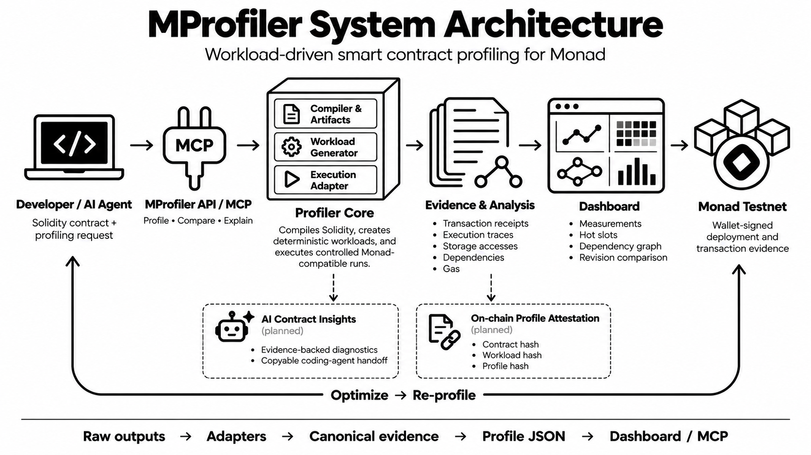
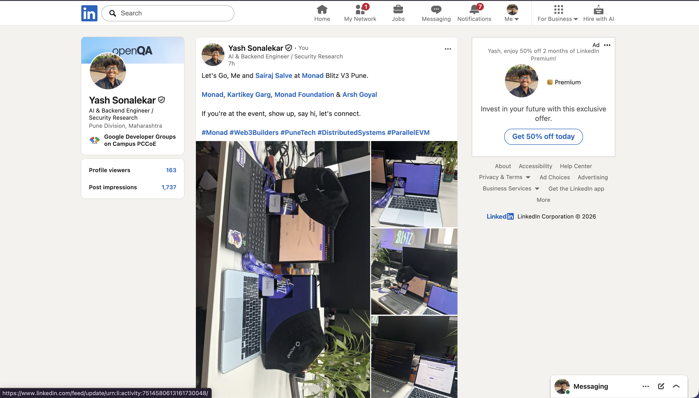
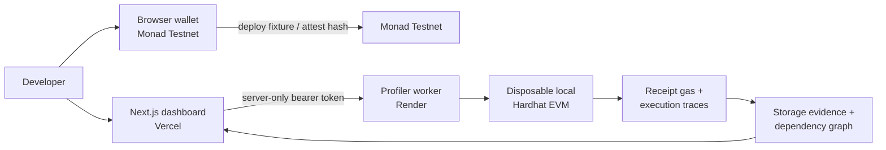

# MProfiler



MProfiler is an evidence-first profiler for Solidity storage workloads on Monad-compatible EVM contracts.

**Live app:** [mprofiler.vercel.app](https://nextjs-eight-liard-18.vercel.app)  
**3-minute product demo:** [Watch on YouTube](https://youtu.be/E0OgbbPYkLk)

It gives developers one practical workflow:

1. Upload a Solidity baseline and define the state-changing calls to exercise.
2. Compile and deploy it into a disposable **local** Hardhat EVM.
3. Inspect real receipt gas, normalized `SLOAD`/`SSTORE` evidence, hot storage slots, and derived dependency edges.
4. Upload a compatible revision and compare it under the identical call manifest and reset state.
5. Review compiler-style Solidity performance diagnostics and copy an evidence-bound handoff into a coding agent.
6. Optionally deploy the public fixture and publish the completed report's Keccak-256 hash through a wallet-signed Monad Testnet attestation.

> MProfiler does **not** measure or claim Monad scheduler decisions, realized parallelism, TPS, or wall-clock throughput. Local receipt gas and traces are measurements; dependency edges and hot slots are derived from those traces; Monad Testnet checks are bounded integration evidence.

## What is included

| Area | Included now |
| --- | --- |
| Deterministic workloads | Independent mapping writes, shared global-counter writes, same-key writes, mixed reads/writes, and read-heavy calls. |
| Local profiler | Uploaded Solidity source or reference fixtures, controlled Hardhat accounts, bounded call manifests, receipt gas, opcode traces, normalized storage accesses, graph edges, waves, and hot slots. |
| Baseline vs revision | The same explicit call manifest and a reset state snapshot before comparison. Gas, calls, accesses, hot slots, and derived edges are compared. |
| Contract insights | Deterministic, source-location diagnostics plus an optional OpenAI review that returns structured, evidence-bound recommendations and a copyable coding-agent handoff. |
| Monad Testnet | Connected-wallet fixture deployment, bounded signer-based integration check, and public report-hash attestation. |
| Hosted demo | Next.js frontend/API on Vercel and the isolated Hardhat worker on Render. |

## Social Media Posting Proofs




## Architecture



The browser never receives the Render worker token. The wallet signs Testnet transactions directly; no wallet private key is sent to Vercel or Render.

## Requirements

- Node.js `>= 20.18.3`
- Yarn `3.2.3` (this repository uses Yarn only)
- A browser wallet for the Testnet UI flow
- Monad Testnet MON only when deploying or attesting on Testnet
- A QuickNode Monad Testnet endpoint only for the bounded CLI integration check

## Quick start: run the full local dashboard

Install dependencies once:

```bash
yarn install
```

### 1. Start the profiler worker

In terminal one, choose a long local token and start the isolated worker:

```bash
MPROFILER_WORKER_TOKEN='replace-with-a-random-token-at-least-24-characters' \
  yarn workspace @se-2/hardhat worker
```

The worker listens on `http://127.0.0.1:4012` by default.

### 2. Start the dashboard

In terminal two, use the exact same token:

```bash
MPROFILER_WORKER_URL=http://127.0.0.1:4012 \
MPROFILER_WORKER_TOKEN='replace-with-the-same-token' \
  yarn start
```

Open [http://localhost:3000](http://localhost:3000) for the product overview, then click **Launch profiler** or open [http://localhost:3000/profile](http://localhost:3000/profile) directly.

You can instead put the two server-only values in `packages/nextjs/.env.local`:

```bash
MPROFILER_WORKER_URL=http://127.0.0.1:4012
MPROFILER_WORKER_TOKEN=replace-with-a-random-token-at-least-24-characters
```

Never use `NEXT_PUBLIC_` for either worker setting.

### Optional: enable OpenAI contract review

Set this server-only value in `packages/nextjs/.env.local`, then restart the Next.js dashboard:

```bash
OPENAI_API_KEY=replace-with-your-api-key
# Optional. Defaults to gpt-6-astra.
MPROFILER_OPENAI_MODEL=gpt-6-astra
```

The Insights route sends the uploaded source, deterministic diagnostics, and available local trace evidence to OpenAI's Responses API. It requests a structured review and keeps the original local evidence visible in the report. Never expose this key with a `NEXT_PUBLIC_` prefix.

### 3. Profile a real contract in the dashboard

1. In **Profile your contract**, upload or paste the baseline `.sol` source (up to 64 KB).
2. Enter the exact Solidity contract name and its constructor arguments as a JSON array.
3. Enter a transaction manifest. Each state-changing call provides its ABI signature, JSON arguments, controlled caller index, and repetition count.
4. Optionally provide a compatible revision source.
5. Click **Compile + profile**. When the job completes, inspect the evidence cards and charts, then open **Compare** or **Analyze contract source**.

For example:

```json
[
  { "function": "setValue(uint256)", "args": [1], "caller": 0, "repeat": 2 }
]
```

Use an ABI signature for an overloaded method. Calls must change state, because only transactions create receipts and execution traces. The local worker queues one active job and up to three waiting jobs. Completed job reports remain in memory for 15 minutes, so keep the worker process running while demonstrating the app.

## What the profiler measures

### Uploaded-contract runs and five reference scenarios

An uploaded-contract run compiles the submitted source with the project's Solidity `0.8.20` or `0.8.24` compiler configuration, deploys it to a disposable in-process Hardhat EVM, and executes the requested call manifest sequentially through controlled accounts. The worker resets that EVM snapshot before executing an optional revision with the same encoded calls.

The **Reference demo** still provides these five deterministic fixture scenarios:

| Scenario | Purpose |
| --- | --- |
| Independent mapping writes | Writes different mapping keys to show distinct-slot access. |
| Shared global-counter writes | Writes one shared counter to expose repeated storage access. |
| Same-key writes | Repeatedly writes a fixed mapping key. |
| Mixed reads and writes | Reads a key, updates it, and updates the counter. |
| Read-heavy workload | Reads observed mapping data and emits `ReadObserved`. |

For each scenario, the runner deploys a fresh local `ProfileWorkloads` contract and submits transactions sequentially through controlled Hardhat accounts. It captures a receipt and `debug_traceTransaction` output for every call.

### Report terms

| Report field | Meaning |
| --- | --- |
| Receipt gas | Actual `gasUsed` reported by the local EVM receipt. |
| Observed access | A normalized `SLOAD` or `SSTORE` from the parsed execution trace. |
| Dependency edge | A graph property derived when calls in one scenario share observed slot evidence and at least one side writes. |
| Hot slot | A slot ranked by observed touches, calls, and derived edge participation. |
| Execution wave/depth | A graph layout derived from the evidence edges. It is not a Monad scheduler measurement. |

Do not infer parallel execution from `Promise.all`, successful receipts, transaction totals, graph waves, or elapsed time.

## Comparison workflow

The comparison route is available from a completed report at `/compare?job=<job-id>`.

MProfiler rejects the premise of a performance comparison unless the baseline and revision use the same generated workload inputs and the runner returns to the same initial local snapshot. The dedicated view shows:

- Total local receipt gas and gas delta
- Successful and reverted call counts
- Observed storage-access counts
- Derived dependency-edge and hot-slot counts
- Per-scenario gas, read, write, and edge values

For an uploaded contract, supply a revision with a compatible constructor and callable methods. The revision may use a different Solidity contract name, such as `SloppyVault` and `OptimizedVault`. MProfiler rejects a comparison unless the encoded inputs match exactly. The Reference demo uses `ProfileWorkloadsRevision`, which implements the same five-method fixture interface:

```text
writeIndependent(uint256,uint256)
writeSharedCounter(uint256)
writeSameKey(uint256)
mixedReadWrite(uint256,uint256)
readHeavy(uint256)
```

The worker accepts one source file per version, caps each source at 64 KB, caps the manifest at 20 call definitions / 100 total calls, runs one job at a time, and uses a five-minute maximum execution time. It is intended for trusted development projects, not as a public multi-tenant contract sandbox.

## Contract insights and coding-agent handoff

Open `/insights` or use **Analyze contract source** from a completed report.

1. Paste Solidity or upload a `.sol` file up to 64 KB.
2. Click **Generate diagnostics**.
3. Review each diagnostic's severity, source location, observed evidence, inference, and recommendation.
4. Click **Copy coding-agent handoff** and paste it into Codex, Cursor, Claude Code, or another coding agent.
5. Apply a minimal revision, compile it, run its tests, then profile it again with the same workload before relying on a delta.

Current checks are deterministic and intentionally conservative:

- `MPF-PERF-001` — shared counter may concentrate writes
- `MPF-PERF-002` — mapping has repeated access sites
- `MPF-PERF-003` — computed storage key needs workload-specific evidence

The insights view is not an external AI model and does not invent measurements. It clearly labels source-based inferences separately from observed trace data. An external AI explanation layer can be added later only with a chosen provider and server-side credential.

## Monad Testnet workflow

### Browser wallet path

On the dashboard:

1. Click **Connect wallet** under **Monad Testnet evidence**.
2. Approve switching to Monad Testnet.
3. Click **Deploy on Testnet** to deploy the public `ProfileWorkloads` fixture from your wallet.
4. After a completed local report, use **Public Testnet attestation** to deploy `MProfilerAttestation` or enter an existing registry address.

### Dedicated signer deployment

Deploy the public workload fixture and attestation registry with the dedicated encrypted Testnet signer:

```bash
yarn workspace @se-2/hardhat deploy:mprofiler-testnet
```

The command verifies Monad Testnet chain ID `10143`, asks locally for the signer password, and writes public addresses plus transaction hashes to `/tmp/mprofiler-testnet-deployment.json`.
5. Optionally provide a public evidence URL, then click **Publish hash**.
6. The UI links both explorer transactions and verifies that the receipt emitted `ProfileAttested` for the exact report hash.

`MProfilerAttestation` stores only:

- the report Keccak-256 hash
- publisher address
- publication timestamp
- optional evidence URI

The full report stays off-chain. Upload it to the URL supplied in the attestation if you need third parties to reproduce and verify the hash.

### Bounded QuickNode integration check

This command is separate from local stress testing. It deploys the small fixture once, submits three transactions, verifies their receipts plus `ReadObserved`, requests QuickNode `prestateTracer` traces for those newly submitted transactions, and writes a JSON report.

1. Copy the Hardhat environment template:

   ```bash
   cp packages/hardhat/.env.example packages/hardhat/.env
   ```

2. Set `QUICKNODE_MONAD_TESTNET_RPC_URL` to your QuickNode **Monad Testnet** endpoint in `packages/hardhat/.env`.
3. Import or create a dedicated encrypted Testnet signer using the repository account command. Fund that public address with Testnet MON.
4. Run:

   ```bash
   yarn workspace @se-2/hardhat profile:testnet-check
   ```

5. Enter the signer password when prompted. The report is written to:

   ```text
   /tmp/mprofiler-testnet-check.json
   ```

This is an integration checkpoint only. Do not use Monad Testnet as the primary batch or stress-testing environment.

## API reference

The browser dashboard uses the Next.js API, which forwards to the authenticated worker.

| Method | Route | Description |
| --- | --- | --- |
| `POST` | `/api/profile/jobs` | Create a local scenario job. |
| `GET` | `/api/profile/jobs/:jobId` | Read queued, running, completed, failed, or expired status. |
| `GET` | `/api/profile/jobs/:jobId/report` | Fetch a completed report. |
| `POST` | `/api/profile/insights` | Run bounded deterministic Solidity diagnostics. |

Example job request:

```bash
curl -sS -X POST http://localhost:3000/api/profile/jobs \
  -H 'content-type: application/json' \
  -d '{"mode":"scenarios","batchSize":2,"controlledAccountCount":2,"revisionArtifact":"ProfileWorkloadsRevision"}'
```

The public API accepts only the `scenarios` mode. Worker requests are authenticated server-to-server with `MPROFILER_WORKER_TOKEN`.

## Deploy the demo: Render worker + Vercel dashboard

### 1. Push this repository

Create your own GitHub repository, replace the scaffold remote, and push the committed project:

```bash
git remote set-url origin <your-github-repository-url>
git push -u origin main
```

Do not push `.env`, `.env.local`, QuickNode URLs, private keys, or worker tokens.

### 2. Deploy the worker on Render

1. In Render, create a **Blueprint** from the GitHub repository.
2. Render reads [`render.yaml`](./render.yaml).
3. Choose a unique service name if `mprofiler-worker` is unavailable.
4. Set `MPROFILER_WORKER_TOKEN` to a random string of at least 24 characters.
5. Deploy and copy the resulting HTTPS service URL.

Render compiles the Hardhat contracts during deployment and starts the isolated worker. It reads the Render-assigned `PORT` automatically.

### 3. Deploy the dashboard on Vercel

1. Import the same GitHub repository in Vercel.
2. Set **Root Directory** to `packages/nextjs`.
3. Add these server-only environment variables for Preview and Production:

   | Name | Value |
   | --- | --- |
   | `MPROFILER_WORKER_URL` | The Render worker URL, without a trailing slash. |
   | `MPROFILER_WORKER_TOKEN` | The exact same token configured on Render. |

4. Deploy the project.
5. Open the Vercel URL and run a `batch size = 2`, `controlled accounts = 2` profile as a live smoke test.

Do not configure a QuickNode endpoint or a deployer private key in Vercel or Render. Testnet wallet transactions happen from the user's browser wallet, and the CLI Testnet checkpoint is designed to run locally with a dedicated signer.

## Verification commands

Run these from the repository root:

```bash
# Solidity compilation and TypeScript checks
yarn workspace @se-2/hardhat compile
yarn workspace @se-2/hardhat check-types
yarn workspace @se-2/nextjs check-types

# Trace parser, deterministic scenario, and comparison tests
yarn workspace @se-2/hardhat test

# Production dashboard build
yarn workspace @se-2/nextjs build

# Direct local scenario report
MPROFILER_BATCH_SIZE=2 MPROFILER_ACCOUNT_COUNT=2 \
  MPROFILER_REVISION_ARTIFACT=ProfileWorkloadsRevision \
  yarn workspace @se-2/hardhat profile:scenarios
```

The direct scenario command writes:

```text
/tmp/mprofiler-scenario-report.json
/tmp/mprofiler-scenario-traces.json
```

## Troubleshooting

| Symptom | Fix |
| --- | --- |
| `The profiling worker is not configured.` | Start the worker and set `MPROFILER_WORKER_URL` plus the matching `MPROFILER_WORKER_TOKEN` before starting Next.js. |
| `Unauthorized.` in the dashboard | Restart Next.js after making the frontend and worker token identical. These values are read at server start. |
| A Next `main-app.js` or chunk returns `404` | Stop the local Next process, remove `packages/nextjs/.next`, restart with `yarn start`, then hard-refresh the browser. |
| Testnet check times out | Confirm the QuickNode endpoint is Monad Testnet, the signer is funded, and retry the bounded command. |
| Wallet extension warnings in `contentscript.js` | These messages come from the wallet extension, not the MProfiler dashboard. Check the browser Network panel for actual dashboard API failures. |
| `localhost:8545` request fails | The scaffold debug contract page expects a separate local Hardhat node. MProfiler's scenario runner uses its own disposable in-process Hardhat EVM and does not require `yarn chain`. |

## Repository map

| Path | Purpose |
| --- | --- |
| `packages/hardhat/contracts/ProfileWorkloads.sol` | Deterministic baseline workload fixture. |
| `packages/hardhat/contracts/ProfileWorkloadsRevision.sol` | Comparable revision fixture. |
| `packages/hardhat/contracts/MProfilerAttestation.sol` | On-chain Testnet report-hash registry. |
| `packages/hardhat/scripts/profile-scenarios.ts` | Local reference-fixture workload runner and report writer. |
| `packages/hardhat/scripts/profile-contract.ts` | Uploaded-contract compiler, isolated local deployer, manifest executor, and report writer. |
| `packages/hardhat/scripts/traceAccess.ts` | EVM storage trace normalization. |
| `packages/hardhat/scripts/profileGraph.ts` | Evidence-linked dependency graph and hot-slot derivation. |
| `packages/hardhat/scripts/worker-server.mjs` | Bounded isolated worker for Render or local use. |
| `packages/nextjs/app/MProfilerDashboard.tsx` | Main profiling dashboard. |
| `packages/nextjs/app/ComparisonDashboard.tsx` | Dedicated comparison workflow. |
| `packages/nextjs/app/InsightsDashboard.tsx` | Solidity diagnostics and coding-agent handoff. |
| `packages/nextjs/components/mprofiler/AttestationCard.tsx` | Wallet-driven Testnet evidence publication. |

## Security and evidence boundaries

- Keep `.env`, `.env.local`, worker tokens, QuickNode URLs, and signer keys out of Git.
- Use a dedicated, funded Testnet wallet or encrypted signer. Never reuse a mainnet private key for a demo.
- Uploaded source is compiled and executed only in the disposable local worker EVM under the documented source, call-count, queue, output, and timeout limits. It is never deployed to Monad Testnet automatically.
- A report hash proves the exact bytes that were attested. It does not make local measurements into Monad scheduler measurements.
- The worker has bounded request size, queue size, output size, report retention, and execution timeout. It is not a multi-tenant arbitrary-contract execution service.
